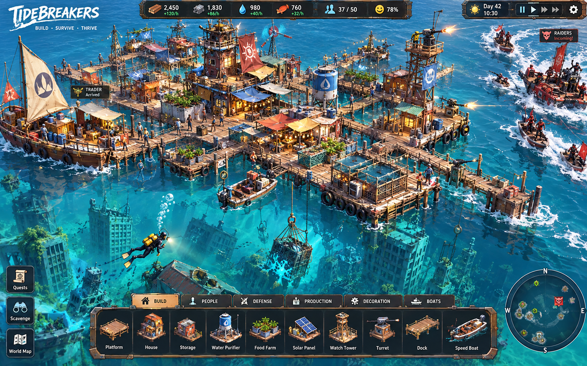
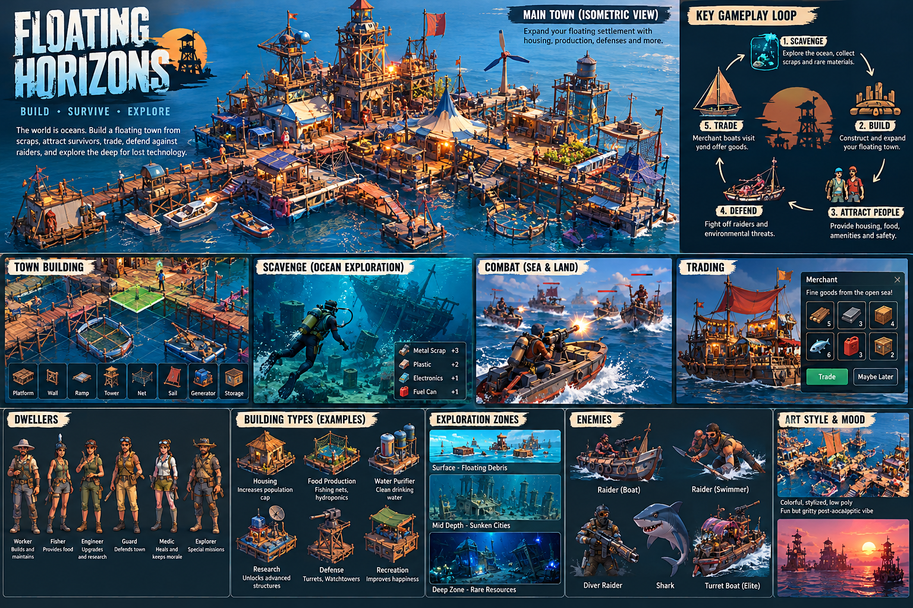
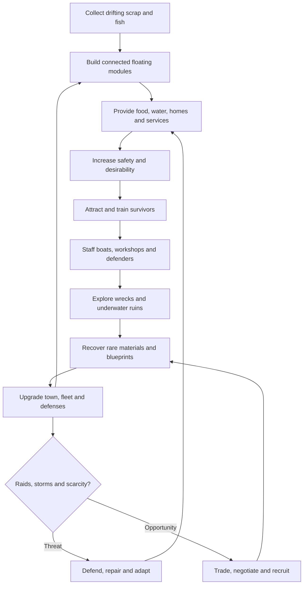

# TIDEBREAKERS — Floating Civilization
## Research-backed creative direction and game design document (GDD)
**Version:** 1.0 concept | **Date:** 19 October 2026  
**Genre:** 3D isometric floating-city builder / survival colony sim / expeditions / tactical defense  
**Format:** Single-player, real-time with pause; proposed PC-first, scalable rendering for future web/PWA consideration  
**Creative pitch:** *When the world sank, civilization learned to float.*





> **Development note:** This is an original design inspired by the broad *drowned world* genre, including the atmosphere of *Waterworld*. Do not copy the movie's characters, named factions, logo, costumes, recognizable vehicle designs, or protected story elements. All systems and numerical targets below are **design proposals**, not measured player behavior or verified market statistics.

---

## 1. Executive concept

Civilization has disappeared below rising oceans. The player commands a tiny community of castaways who lash together salvage, docked boats, shipping containers, and scrap into a floating settlement. They balance safe drinking water, food, shelter, energy, jobs, recreation, and protection. As their floating city becomes safer and more attractive, survivors arrive with distinct talents and needs. Meanwhile, the ocean is both the resource economy and the primary threat: volatile currents bring scavenging opportunities, merchant ships, storms, smugglers, pirates, and swimmers who sabotage defenses from underneath. Players dispatch crews by boat to floating wreckage, collapsed oil rigs, flooded shopping malls, and submerged metro stations. Expeditions can become tactical encounters against rival crews or wildlife, requiring combat, retreat, and recovery.

### Key design pillars
1. **Every piece of scrap has a second life.** Construction visibly reuses barrels, plastic, boat hulls, rooftops, cranes, shipping containers, solar panels, and nets.
2. **A settlement people want to live in.** Resident arrival depends on free beds and a nuanced desirability score, not simply time passed.
3. **An ocean with agency.** Tides, currents, weather, drifting resources, visible ruins, visitor boats, and raider routes continuously change choices.
4. **Exciting expeditions, meaningful returns.** Exploration brings scarce research components, rescue opportunities, blueprints, fuel, unique items, and danger.
5. **Defend intelligently, not just with damage numbers.** Enemies can approach by speedboat, climb onto platforms, swim beneath defenses, or damage the float structures.
6. **Colorful danger.** Readable toon-shaded geometry, expressive residents, bright water, chunky silhouettes, colorful decorations, and occasional dramatic storms.

### Audience and player fantasy
Players who enjoy resource chains, visibly growing settlements, automation, survival decisions, and manageable tactical challenges. The ideal experience alternates between peaceful optimization and bursts of risk, with optional difficulty settings for raid frequency and severity.

### Design guardrails
- **Primary mode:** indirect control of a functioning settlement; the player directs tasks, boats, and combat squads rather than personally controlling an avatar full-time.
- **Camera:** 3D perspective/orthographic-like isometric, orbit, zoom, and angled sea-level cinematic view; underwater mode uses cutaway or dedicated mission scene.
- **Combat:** light real-time tactical combat with pause; not an FPS or a full naval simulator.
- **No tedious individual micromanagement:** global jobs and priorities, with optional squad orders.
- **Physical spectacle with manageable code:** structures bob and flex subtly, but simulation uses grid/support rules rather than expensive true fluid-body physics.

---

## 2. Reference research / competitor analysis

| Game | Relevant verified features | What to learn | Our distinctive angle |
|---|---|---|---|
| **Flotsam** (Pajama Llama Games, 2025 full release) | Builds floating towns from plastic and driftwood; drifters, recycling, specialist recruitment, ocean exploration, water and food | Strongest visual and systemic benchmark for garbage-to-settlement transformation | Make tactical raids, diver infiltration, differentiated boat combat, and high-risk offshore squad missions more central |
| **Havendock** (YYZ Studio, 2025) | Floating ocean colony, autonomous settlers, facilities, farming, research, boats and underwater exploration | Accessible resident simulation and production automation | More dynamic defense and richer seaborne factions / negotiations |
| **Raft** (Redbeet Interactive, 2022) | Ocean debris, raft construction, underwater diving, enemies and exploration | Resource collection is motivating when every discovery improves the home base | Replace first-person survival with city-scale command plus playable tactical expeditions |
| **Frostpunk** (11 bit studios) | Tough colony needs, morale and difficult policy choices | Consequences can give settlement planning drama | Less oppressive tone, softer entry, colorful environments |
| **Against the Storm** (Eremite Games) | Pressure versus rewards, distinct settlements and timed events | Progression gains depth with goals and situational challenges | Persistent flagship town, ocean exploration, defense |
| **Anno series** (Ubisoft) | Production chains, citizen demands, trade routes | Upgrade needs should create predictable economic complexity | Modular floating layouts and opportunistic maritime economy |

**Positioning judgment:** The creative opening is **not** simply “Flotsam plus fighting.” It is a settlement where **happiness attracts residents; residents enable expeditions; expeditions unlock infrastructure; infrastructure raises trade value and security; prosperity draws tougher pirates**. This feedback system should define the game.

**Reference sources** (primary store/developer-facing descriptions, consulted October 2026):
- Flotsam: https://store.steampowered.com/app/821250/Flotsam/
- Havendock: https://store.steampowered.com/app/2020710/Havendock/
- Raft: https://store.steampowered.com/app/648800/Raft/
- Frostpunk: https://store.steampowered.com/app/323190/Frostpunk/
- Against the Storm: https://store.steampowered.com/app/1336490/Against_the_Storm/

These are feature comparisons, not claims about actual sales, retention, or customer preferences.

---

## 3. The world, fiction, and emergent storytelling

### Premise
Decades after an acceleration in warming, collapse of ice sheets, coastal inundation, and other fictional catastrophes, survivors are scattered among raft communes, offshore towers, roaming merchant fleets, and pirates. **Scientific distinction:** real-world climate change alone does not imply that literally all continental land could vanish beneath the ocean; this is a deliberately exaggerated speculative disaster. In fiction, geological subsidence, ancient megastructures, or an alternate-history cataclysm can explain the total-submersion setting.

### The player's starting point
A rusting lifeboat and three interconnected pontoons on the edge of an old coastal metropolis. Six survivors, two days of clean water, a hand net, a damaged motorboat, and a few bags of salvaged scrap. A distant distress signal promises additional survivors if the player can stabilize basic needs.

### Factions
- **Freefloaters:** refugees looking for water, safety, and a new beginning.
- **Tide Merchants:** neutral trading families on cargo barges; reputation unlocks rare inventory.
- **Red Wake:** raiders with makeshift speedboats, hooked grappling lines, and occasional divers.
- **The Lantern Guild:** engineers with old-world power cells, submerged maps, and sophisticated tech.
- **Coralkeepers:** environmentalist divers who trade food and medicine for reduced pollution.
- **Iron Fleet:** militarized raider armada with armored patrol craft (late game).

### Narrative format
Environmental storytelling and short events rather than long mandatory cutscenes. Example: a half-submerged cinema may contain a projector, batteries, and a diary, enabling a new recreation building and optional story quest.

---

## 4. Core gameplay loop



**30-second loop:** spot salvage, queue collection, place a platform, assign a resident.  
**5-minute loop:** solve supply bottleneck, rescue new settler, construct useful building, assess a merchant offer.  
**20-minute loop:** prepare a scavenging trip, visit a danger zone, earn high-value loot, reinforce defenses.  
**Long-term loop:** move from six castaways to a multi-district harbor with trade networks, research, and powerful boats.

### Intended session pacing (starting targets to playtest)
- 0–5 minutes: tutorial collection, freshwater, first shelter.
- 5–15 minutes: expand modules, fishing, first settler arrival.
- 15–30 minutes: first trader, craft speedboat, low-stakes salvage mission.
- 30–45 minutes: telegraphed starter raid with easy victory conditions.
- 45–60 minutes: unlock a new biome and meaningful building choice.

---

## 5. Construction and town planning

### Buildable space
The town sits on **snap-connected floating foundation modules**, with flexible shapes formed from 2m×2m standard tiles (proposed authoring scale). Foundations can be wood-and-barrel rafts, steel pontoons, refurbished ship decks, container pontoons, or large hulls. Buildings occupy tiles and may bridge across neighboring modules if connections are strong enough.

### Construction placement rules
- Must be adjacent to or connected by walkable paths to an existing safe module, unless deploying a new anchored outpost.
- Every occupied module has **buoyancy capacity** and **load**; overloading adds a repair penalty before severe structural failure on higher difficulties.
- Connection joints have durability; raids and waves can damage them.
- Buildings display readable ghost previews: green valid, orange missing logistics, red blocked/overweight.
- Service radius is determined by **walkable path distance**, not merely Euclidean radius.
- Docks require open water, turning space, and connected storage; avoid building a harbor that boats cannot path into.
- Height tiers: base platform, one- and two-storey superstructures, towers up to capped build height; shadows can fade under occlusion.

### Building catalog

| Category | Early | Mid-game | Late |
|---|---|---|---|
| Foundations | Barrel raft, driftwood walkway | Steel pontoon, boat-hull platform | Reinforced floating drydock |
| Housing | Tarp bunk, scrap shack | Family cabin, stacked container homes | Elevated apartment cluster |
| Water | Rain collector, boil pot | Desalination tank | Solar desalination plant |
| Food | Hand fishing dock, seaweed boxes | Fish farm, hydroponic plot, kitchen | Aquaculture facility |
| Storage | Salvage bins | Cargo containers, fuel locker | Automated sorting depot |
| Production | Scrap workbench | Smelter, plastics recycler, mechanical workshop | Advanced fabrication yard |
| Energy | Hand-crank generator | Windmill, solar raft | Ocean-current turbine |
| Mobility | Paddle skiff, improvised rowboat | Motor skiff, trader pier, dive boat | Armored escort, exploration vessel |
| Security | Bell alarm, barricade, lookout | Harpoon station, watchtower, patrol dock | Electrified net, sonar beacon, cannon turret |
| Civic | Lanterns, communal fire | Market, clinic, canteen, playground | School, festival pier, cinema |
| Research | Charting desk | Radio tower, laboratory | Deep-sea engineering station |

### Building progression and architectural identity
Town begins jagged and imperfect. In later stages, improvements **retain an improvised aesthetic**—a solar farm still looks built from scavenged panels, a tower uses an old tugboat cabin, and the market extends from a refitted fishing trawler. Colorful flags and night lighting help navigation and personality.

### Optional mechanic: Salvage architecture
Rare expedition discoveries can be mounted directly as **unique structures**: a ferris-wheel ring becomes a landmark, a subway carriage becomes a dormitory, or a crashed helicopter fuselage becomes a defensive lookout. These dramatically change the skyline and provide distinctive unlocks.

---

## 6. Residents, jobs, attraction and happiness

### Resident model
Each dweller has name, portrait, age bracket, traits, proficiency, health, stamina, morale, needs, home, job, and task queue. Do not simulate unnecessary needs at per-second granularity: batch daily economics and update visible movement separately.

**Jobs:** scavenger, fisher, gardener, cook, engineer, hauler, purifier operator, medic, trader, diver, boat pilot, defender, researcher, and entertainer. Residents automatically select tasks based on work priority and path availability; manually pinned assignments override default choices.

### Settlement attractiveness (proposed 0–100 score)

`Attractiveness = 0.22 Housing + 0.20 Essentials + 0.18 Safety + 0.15 Jobs + 0.15 Amenities + 0.10 Reputation`

Each component is normalized 0–100. Housing considers usable spare beds and quality; Essentials covers food/water reliability; Safety reflects raids, lighting, health and defenses; Jobs reflects capacity and skill matching; Amenities measures reachable civic buildings and decoration; Reputation derives from successful rescues, trade, ethics, and faction actions.

**Important balancing constraints**
- A welcoming town still cannot recruit if there are **no spare beds** or no arriving ships.
- Below 40 attractiveness: rare arrivals and higher emigration pressure.
- 40–59: slow arrivals.
- 60–79: steady arrivals.
- 80+: higher-quality volunteers and visitors, but also more visible to powerful raiders.
- These thresholds are starting hypotheses, to balance with playtesting.

### Recruitment event calculation (illustrative)
At periodic rescue/arrival checks, roll for visitors using the attractiveness band and regional traffic rate, capped by population and transport capacity. The UI should report: *“3 new settlers interested: housing 72, food 90, safety 45 — raider pressure reduces arrivals.”* Residents have agency: some accept, some ask for a school, clinic, or secure housing before moving in.

### Resident traits and stories
- **Tinkerer:** repairs engines 20% faster but dislikes long expeditions.
- **Deep Lungs:** +15% dive duration.
- **Barterer:** better merchant offers, low combat skill.
- **Former Raider:** bonus enemy-route knowledge, distrust penalty with certain settlers.
- **Community Builder:** improves nearby morale.
- **Fear of Water:** stress on exposed walkways, increased need for enclosed housing.

These are example modifiers; avoid making traits severe enough to punish players for accepting rescued survivors.

### Civic happiness
Happiness responds to adequate nutrition, consistent water supply, housing crowding, recreation, work-rest balance, safe routes, injuries, and successful defenses. **Avoid an opaque single happiness percentage:** clicking the rating opens a cause breakdown, trends, and suggested fixes.

---

## 7. Resources and economy

| Resource | Main sources | Main uses | Risk / scarcity |
|---|---|---|---|
| Driftwood | Floating debris, wrecks | Basic foundation, fuel | Common, space hungry |
| Plastic | Flotsam fields, sorting nets | Float components, insulation | Common, pollution tradeoff |
| Metal scrap | Ships, docks, drowned vehicles | Reinforced structures, weapons | Mid-game bottleneck |
| Fabric / rope | Fishing gear, ship salvage | Sails, hammocks, nets | Weather exposure |
| Fresh water | Rain collection, distillation | Drinking, food production | Critical daily need |
| Food | Fish, seaweed, hydroponics | Resident sustenance | Preservation requirement |
| Fuel | Trading, salvage, refining | Motorboats, generators | Expedition constraint |
| Electronics | Underwater offices, old ships | Research, sensors, automation | Expedition reward |
| Chemicals | Clinics, factories | Medicine, crafting | Toxic contamination |
| Trade tokens | Merchants, contracts | Imported goods | Scarce currency alternative |
| Rare cores | Deep sites, elite wrecks | Advanced tech | High-risk late game |

### Resource processing examples
`Fishing dock -> raw fish -> kitchen or smokehouse -> food`  
`Driftwood + plastic -> buoyant foundation`  
`Metal scrap -> sorted metal -> structural fittings + defense parts`  
`Seawater + energy -> freshwater + brine`  
`Old electronics + metals -> radio/sonar module`

### Storage and logistics
- Resources occupy inventories and containers, with one central UI overview.
- Residents carry small stacks; carts/dollies become mid-game efficiency upgrades.
- Assign dock-to-storage zones; allow boats to auto-unload.
- Initial version can implement **abstracted global stockpiles** with visible worker trips for clarity; fully local inventory networks can come later.
- Weather affects fish supply, rainwater output, wind power, and boat safety.

### Trading
Scheduled merchant visits based on world traffic, harbor facilities, faction relations, and beacon reputation. Each merchant has specialties (fuel, medicine, rare electronics, seeds), limited stock, and rotating requests. Player options: direct barter, currency purchase, standing orders, or escort contracts. Merchants should never spawn if no docking route exists; they can instead radio offers remotely.

**Sample visit:** “The Blue Gull” needs 12 clean-water units, offers 6 fuel and a damaged solar panel. Accept, negotiate with high-trust traders, or decline.

---

## 8. Ocean exploration and scavenging missions

### Overworld map
A stylized chart divided into connected **regions** with currents, storm forecasts, visibility, enemy control, and discovery points. New regions open via radio signals, rescued navigators, sonar, maps, and research. Travel consumes fuel, time, and exposure to danger.

### Mission sites
1. **Driftfield:** low risk; nets gather floating plastic and wood; occasional rival salvager.
2. **Ship graveyard:** climb rusting hulls, cut open locked cargo holds, defend from marauders.
3. **Drowned suburb:** shallow diving, flooded roads, rooftops, building interiors.
4. **Submerged shopping mall:** indoor flooded labyrinth, electronics, trapped survivors.
5. **Collapsed oil platform:** rare fuel and equipment, strong raider occupation.
6. **Sunken research station:** deep-sea apparatus, toxic leaks, boss-like encounter.
7. **Coral megastructure:** peaceful biological zone, harvesting ethics, specialty medicine.
8. **Abandoned naval dock:** armored craft parts, traps, and faction confrontation.

### Mission workflow
**Choose target → select vessel → assign crew → load tools / oxygen / weapons → travel → explore / fight / collect → retreat or extract → repair and unload.**

Crew roles: skipper, mechanic, diver, salvager, medic, and guard. A crew of 2–4 is enough for MVP missions; later specialist teams enable alternative approaches.

### Scavenging presentation / player controls
**Recommended first release:** dedicated compact 3D isometric **mission arena** with tactical click-to-move and interaction icons. Keep combat and salvage on the same control model as colony play. The player selects crew; right-click navigates; click debris to salvage, door to breach, and hostile to attack; ability icons handle heals, flares, sonar, grapples, or smoke.

**Surface missions:** steer boat along bounded navigable water (autopilot path); board platforms; fight raiders; crack caches; evacuate.  
**Underwater missions:** switch to a stylized cutaway or transparent-water layer with controlled diver movement between waypoint nodes; oxygen, depth, visibility, and threats limit the route. Avoid full free-swimming physics in MVP.

### Underwater mechanics
- **Oxygen:** displayed as a continuous bar; consumption rises with work and injuries.
- **Depth:** deeper sites require better tanks and diving suits.
- **Visibility:** silt clouds, night, and storms reduce detection and spotting.
- **Noise:** tools and motors can alert wildlife or enemy divers.
- **Cargo weight:** heavy finds slow extraction and require lift balloons/cranes.
- **Extraction decision:** quit with acquired loot, or push onward for a valuable cache.
- **Hazards:** unstable wrecks, entanglement, leaks, sharks, hostile divers, electrical discharges in fictional damaged equipment.

### Mission rewards
Common raw materials are available close to home. Missions provide **rare bottleneck resources** (blueprints, engines, medical supplies, batteries, specialist survivors), ensuring the risk has strategic value rather than merely delivering more wood.

### Fail states and recoverability
- Injured crew survive if evacuated on time; missing crew can trigger later rescue quests.
- Abandoning loot is often better than losing the vessel.
- A destroyed vessel is a serious economic loss, but replacement progression should be achievable without a restart.
- Offer a “low-risk missions” mode for town-focused players.

---

## 9. Combat, raids, and town defense

### Threat archetypes
| Enemy | Approach | Behavior | Counterplay |
|---|---|---|---|
| Loot skiff | Water surface | Hits vulnerable outer storage | Watch posts, patrol boats |
| Raider speedboat | High-speed flank | Shoots then grapples docks | Harpoon tower, channeling barricades |
| Boarding party | Platform paths | Attacks workers and steals stockpiles | Guard patrols, chokepoints |
| Saboteur swimmer | Below waterline | Cuts joints, disables desalination | Underwater nets, sonar, diver patrol |
| Enemy diver | Submerged approach | Mines docks and steals electronics | Sonar buoys, defensive divers |
| Heavy gunboat | Long-range water | Bombards exposed modules | Decoys, reinforced hulls, escort boats |
| Wildlife hazard | Sea / wreck site | Ambushes divers | Lights, sonar, safe pathing |

### Raid flow
1. **Foreshadow:** radio chatter, stolen nearby supplies, scout boats, suspicious bubbles.
2. **Preparation:** 1–3 minutes of warning scaled by difficulty; civilians shelter; player assigns guards and repairs.
3. **Approach:** raiders choose a route, e.g., direct attack, waterborne flanking, swimmer sabotage.
4. **Engagement:** towers fire in line of sight, defenders move and take cover, enemy boarding triggers local fights.
5. **Outcome:** surviving raiders retreat or negotiate; damage and stolen goods are logged; successful defenses boost reputation.

### Combat interactions
- Boats have speed, armor, crew slots, fuel, cargo, turning radius, and weapon mount slots.
- Stationary defenses have arcs, range, ammunition, upkeep, and line of sight.
- Guards have basic ranged/melee attacks, morale, and a retreat threshold.
- Friendly-fire avoided by default, unless using advanced explosive weapons on higher difficulty.
- Platform fire, water leakage, and cut walkways introduce positional consequences.
- Civilians auto-flee toward designated safe zones, if paths remain open.

### Tactical strategic decisions
- Invest in patrol ships or stationary towers?
- Build a narrow defensive channel and risk trade congestion?
- Keep best divers on expeditions or station them at home against underwater attack?
- Maintain faction reputation to reduce hostility or collect bounty rewards?

### Fairness rules
- Never launch an untelegraphed devastating attack early in the game.
- Scale raids primarily by wealth, threat heat, region, and time—not only population.
- Limit raider acquisition of unattended cargo to avoid irreversible spirals.
- Add periodic recovery windows and repair assistance after heavy attacks.
- **Optional peaceful mode:** replace lethal raiders with piracy negotiation, storms, supply shortages, and rescue events.

---

## 10. Boats and fleet gameplay

| Vessel | Crew | Function | Unlock path |
|---|---:|---|---|
| Paddle skiff | 1 | Nearby scrap collection | Starting boat |
| Salvage dinghy | 2 | Close-range ruins and lightweight recovery | Workshop |
| Motor skiff | 2–3 | Fast missions and evacuation | Engine salvage |
| Dive boat | 3–4 | Oxygen stores, diving crane | Diving technology |
| Armored patrol craft | 3–4 | Escort and anti-raider patrol | Security research |
| Trading barge | 2–5 | Bulk freight / trade route | Merchant reputation |
| Deep exploration ship | 4–6 | Remote biomes, strong storage | Late-game tech |

**Fleet upgrades:** engine, hull plating, weapon mount, sonar, fuel tank, lifting crane, salvage net, oxygen refill, life ring, and compartment storage.

**Boat command model:** right-click on navigable water to give movement orders; optionally draw patrol route; motorboat follows spline path, turns using limited acceleration, and uses avoidance against structures and other vessels.

**Important technical limit:** avoid boat-to-boat full rigid-body collisions initially. Simple steering + motion curves + wave bobbing + wake effects deliver convincing presentation and easier debugging.

---

## 11. Weather, events, and changing ocean

### Weather
- **Clear:** great visibility, strong solar production, normal raider spotting.
- **Rain:** boosted collectors, decreased visibility and morale for exposed work.
- **High wind:** increased wind generation, risky small-boat travel.
- **Storm:** damages unsupported modules, interrupts fleets, creates rare salvage aftermath.
- **Fog:** underwater/near-surface threats harder to see.
- **Heat wave:** increases water consumption; offers excellent solar yield.

### Event examples
- Survivor convoy needs urgent drinking water.
- A floating whale carcass attracts predators and rare materials.
- Merchant auction: bidding with parts instead of tokens.
- Radio message from a crashed research submarine.
- Dockworkers accuse a new arrival of being a raider informant.
- Old-world container drift: open it for rewards, but risk contamination.
- Strange bioluminescent tide draws visitors and improves mood for a night.

### Difficulty controls
Raider frequency, combat lethality, weather intensity, water consumption, resource density, settler churn, and mission risk. Support a forgiving default and a harsher survival scenario.

---

## 12. Technology and progression

### Era 1 — Castaways
Hand tools, driftwood, barrels, fishing, boil water, basic bunk, paddling boat, scavenged radio.

### Era 2 — Village afloat
Workshops, metal support, rain harvesting, desalination, merchant dock, guard training, motorboats, hydroponics.

### Era 3 — Harbor town
Vertical housing, civic services, mid-depth diving, trade contracts, renewable power, sonar, patrol fleet.

### Era 4 — Floating city
Harbor districts, advanced salvage cranes, automated recycling, faction diplomacy, deep-sea expeditions, heavily armored defenses, landmarks.

### Technology tree categories
**Materials / Water & Food / Power / Transport / Civic / Security / Diving / Commerce**. Unlocks derive from both lab research and recovered *blueprint fragments*, so exploration provides an alternative to pure time-based technology.

### Prestige without resets
Build distinct districts, unlock architectural skins, create veteran specialist crews, negotiate allied trading routes, and recover the history of the drowned world. A prestige reset is not necessary to make late game rewarding.

---

## 13. User interface and camera

### Main scene
- Camera pitched around 35–50 degrees down from horizontal; orbit via Q/E or middle mouse, zoom with wheel, pan with WASD or edge scrolling.
- Resource bar on top: material stockpiles, food, water, power, residents, satisfaction.
- Bottom toolbar tabs: Build, People, Work, Boats, Defense, Research, Trade.
- Mini-map on bottom-right; notifications on right with threat priority.
- Hover highlight for interactable buildings and salvage; click for contextual info panel.
- **Underwater overlay:** temporarily darkens surface transparency and reveals relevant submerged salvage sites and raider divers.

### Important UX states
1. **Build mode:** rotation preview, footprint, price, capacity/load impacts, connected path warning.
2. **Citizen mode:** roles, idle workers, missing jobs, happiness sources, available beds.
3. **Trade mode:** merchant offers, stock limits, reputation, docks.
4. **Defense mode:** approach arcs, lookout coverage, squad priorities, threat timeline.
5. **World map:** discovered wreck sites, projected fuel, time, danger and loot.
6. **Mission mode:** select crew, interact, recover cargo, retreat, overwatch / attack.

### Readability specifications
- Cartoon silhouettes readable when zoomed out.
- Defensive units differentiate using shape and color, not color alone.
- Path arrows and dock no-entry water zones shown in overlays only.
- Target 60 FPS on reference desktop with a controlled 20–40 building starting town; tune for your hardware and deployment plan.
- Respect accessibility: font scaling, color-blind-friendly icons, subtitles for alerts, pause speed and hotkey remapping.

---

## 14. Art direction — colorful low-poly with toon shading


### Target look
- **Mood:** whimsical engineering in a dangerous world; bright midday aquamarine water, golden-hour oranges, teal steel, faded reds, canvas whites, sun-bleached yellow.
- **Geometry:** simplified silhouettes with modest bevels and intentional medium-poly focus objects; avoid flat untextured primitive-only appearance.
- **Textures:** hand-painted roughness / color variation, edge wear, stripes, rust and readable salvage labels; not photorealistic PBR.
- **Shader:** ramped diffuse lighting (2–4 tone bands), subtle outlines on selected characters/objects, warmer rim lighting, stylized specular and soft ambient occlusion.
- **Sea:** gradient depth tint, foam wakes, glitter highlights, transparent shallows, underwater ruin silhouettes, floating particles.
- **People:** chunky proportions, expressive walk/work/idle/celebrate/flee cycles, varied clothing and hats.
- **Animation:** idle wind turbines, bobbing modules, pulley cranes, rope sway, fish jumps, boat wakes, gulls, neon signs at night.

### Proposed palette
| Element | Color | HEX |
|---|---|---|
| Shallow water | Tropical aqua | `#28C7C4` |
| Deep ocean | Ocean blue | `#086F9C` |
| Scrap rust | Oxide red | `#C95B3C` |
| Painted steel | Sea green | `#4A9A8E` |
| Roof canvas | Sunflower | `#F8C55B` |
| Wood | Warm brown | `#9A6B43` |
| Raider identifiers | Crimson | `#B93B46` |
| UI background | Deep navy | `#142B38` |
| Positive UI | Seafoam | `#79DFC1` |

### Asset families to build
- 5 modular floating foundations (2m, 4m, corner, transition, elevated).
- 8 walkway/dock connectors, 3 ladder sets, gangways, rope barriers.
- 12 early buildings with upgrade parts and 3 roof variants.
- 6 boats, 3 merchant vessels, 4 raider craft.
- Survivor bodies and clothing as interchangeable meshes (rather than unique characters only).
- Fish, birds, sharks, float debris, submerged cars, street lamps, signs, wreck ships.
- VFX: splash, foam, water spray, bubble trails, sparks, smoke, explosions, storms.

### Concept art assets included with this document
- **Main playable scene mockup:** `a_widescreen_colorful_stylized_3d_isometric_game.png`.
- **Gameplay design and feature board:** `a_high_detail_game_concept_pitch_overview_poster_i.png`.

These visuals are **illustrative concept art**, not screenshots of an implemented, playable game. Any depicted HUD values, typography, or element placements should be recreated and verified in the real game UI.

---

## 15. Proposed technical architecture

### Engine recommendations
**For desktop-first:** Unity (URP + Shader Graph) or Godot 4 (Forward+ rendering) are realistic paths for stylized isometric 3D. Both support custom water, toon shaders, mesh instancing, UI, animation, camera controls, navigation, and scripted AI.

**For a web/PWA-ready build:** Babylon.js + TypeScript + Vite offers browser-first rendering and direct control of loading, assets, UI, and deployment. Three.js is another option if you prefer composing systems yourself. Web-native is viable for a deliberately constrained map/visual target, not automatically an easier build.

**Recommended implementation choice based on scope:** Godot 4 for a solo desktop prototype; Babylon.js + TypeScript if browser/PWA is non-negotiable. These are design recommendations, not benchmark results for your hardware.

### Suggested software systems
```text
Game
 ├── SimulationClock (pause / x1 / x2 / x3)
 ├── SettlementGrid (module placement, connectivity, float load)
 ├── BuildingSystem (construction, damage, services)
 ├── EconomySystem (resource inventories, production, recipes)
 ├── ResidentSystem (needs, jobs, task priority, pathfinding)
 ├── AttractionSystem (housing, amenity, reputation, arrivals)
 ├── MaritimeSystem (water navigation, boats, docking)
 ├── WorldMapSystem (sites, routes, factions, current/weather)
 ├── MissionSystem (crew, site encounters, loot, extraction)
 ├── CombatSystem (weapons, targeting, cover, raider AI)
 ├── EventDirector (raids, traders, weather, rescue)
 ├── ResearchSystem (unlocks, blueprints, upgrades)
 ├── SaveLoadSystem (versioned snapshots)
 └── Presentation (camera, shaders, effects, UI, audio)
```

### Important implementation details
- **Authoritative simulation:** separate settlement/economy calculations from animations, visuals and UI. Enables fixed-step updates, speed controls, deterministic replay tests.
- **Placement:** grid or hex? **Choose square grid** for rectilinear scrap platforms, walkways, container stacks and clear adjacency.
- **Walking:** build graph of platform connections; run A* over graph or grid. Update when construction, destruction, or walkways change.
- **Boat navigation:** maintain a navigable polygon/steering grid around the town; distinct from land walkability.
- **Underwater navigation:** separate waypoint graph or pathfinding layer; do not reuse walking grid across depths.
- **Jobs:** priority task queue with reservation (one worker per reserved task), capacity assignment, stuck-entity recovery.
- **Persistence:** save seed, inventory, modules, jobs, people, ship data, research, day, and event director state; use explicit schema versions.
- **Performance:** instancing for debris/platform props, static batching for buildings, LODs for camera zoom, lower-frequency simulation ticks for offscreen entities, visualized pathfinding diagnostics.
- **Damage:** building health, platform health, and connection health are separate; resist cascading whole-town destruction outside optional hard mode.

### Example schema (language agnostic)
```json
{
  "buildingId": "water_purifier_01",
  "footprint": [2, 2],
  "category": "essentials",
  "requiresPath": true,
  "cost": {"wood": 18, "metal": 12, "plastic": 8},
  "workers": 1,
  "recipe": {"inputs": {"seawater": 10, "energy": 2}, "outputs": {"water": 6}},
  "health": 100,
  "mass": 35,
  "satisfactionBonus": 0
}
```

**Technical caution:** Do not attempt full 3D free-form swimming, true flexible raft structural physics, city-scale simulation, seamless maritime world travel, complex AI combat, multiplayer, and PWA support simultaneously. They multiply implementation cost.

---

## 16. MVP: a vertical slice worth playing

### Essential 1.0 prototype scope
- 1 small town map surrounded by ocean, fixed waterline and light wave animation.
- Modular raft snapping and walkable platform graph.
- 10–12 buildings (foundation, house, fishing dock, purifier, storage, recycler, workshop, guard tower, market/dock, lookout, garden, clinic).
- 5–8 core resources (wood, metal, plastic, food, water, fuel, electronics, trade tokens).
- 6 starting settlers; scalable to ~30 for early testing.
- Job AI: collect, haul, build, fish, purify, repair, defend.
- Attraction score + settler arrival events.
- 1 merchant boat + basic barter UI.
- 1 defense encounter: hostile speedboat + 2–3 boarders.
- 1 scavenging expedition scenario: ship graveyard with loot, hostile crew and extract button.
- Pause/speed controls, simple UI, save/load.

### Phase 2 after proving the loop
- Underwater mission scene with oxygen, diver movement, and submerged loot.
- 2 additional boats, fleet upgrades, weather variants.
- Raider swimmer/saboteur, sonar and net defenses.
- 2 factions, trade reputation, extra recipes and resident traits.

### Phase 3 expansion
- Region map, deep-sea sites, larger towns, mission variety, specialist quests, vertical housing, advanced automation.

### Deferred on purpose
Multiplayer/co-op; fully seamless open world; first-person diving; procedural interior buildings; full naval physics; complex water flooding; thousands of active residents; console/mobile port; procedurally voiced narrative.

---

## 17. Suggested 12-week solo-prototype roadmap

This is an **ambitious planning target** assuming prior game-programming experience and access to prototype assets; not a guaranteed delivery estimate. A complete commercial game requires much longer.

| Week | Target | Definition of done |
|---|---|---|
| 1 | Project setup and camera | Orbit/zoom/pan, ocean, simple stylized lighting |
| 2 | Foundation editor | Placement preview, snapping, walkway connectivity |
| 3 | Building catalog | 6 functional buildings, costs, repair and inventory |
| 4 | Resource production | Fishing, water, harvesting, queues, day ticks |
| 5 | Residents/jobs | Movement, task reservations, housing / needs |
| 6 | Town attraction | Satisfaction breakdown, arrival and recruitment events |
| 7 | Boats | Simple steering, docking, cargo and fuel |
| 8 | Trading | Merchant route, inventory, barter, trading dock |
| 9 | Defense | Enemy boat spawn, guard AI, turret, damage states |
| 10 | Expedition | Separate shipwreck scenario, crew, loot, extraction |
| 11 | Polish/systems | Save/load, tutorial prompts, sounds, readable HUD |
| 12 | Playtest/fix | 30-minute replayable slice, telemetry notes, bug triage |

### First playable milestone test
A tester unfamiliar with the controls should be able to: collect scrap; build two platforms; make food and water; attract a resident; trade for fuel; survive a small attack; send two workers to a wreck; retrieve a blueprint; unlock a new building—without verbal help.

---

## 18. Balance models and example numerical targets

**Caution:** These are *initial tuning assumptions*, not externally validated optimal values.

### Daily survival baseline
- Starting residents: 6; initial 2 houses, 8 bed spaces.
- Each resident consumes 1 food and 1 water unit/day.
- One fishing dock at base productivity yields 8 food/day (weather/staff modifiers).
- Starter purifier yields 8 clean-water units/day; power input required.
- Initial ship carries 20 cargo units and uses 1 fuel per short travel segment.
- Low-tier raid budget: 2 boarders + 1 skiff; advanced raider attacks begin only after player has defenses.

### Suggested threat director
`ThreatHeat = 0.30 Wealth + 0.20 ReputationVisibility + 0.20 MapZoneDanger + 0.15 DaysSurvived + 0.15 RivalHostility`

Normalize the five inputs 0–100. Ensure an early-game safe period; clamp chance and raid strength by tech milestones. A successful high-damage raid temporarily reduces danger or forces enemy retreat, protecting against death spirals.

### Desired tradeoffs
- Compact towns: efficient delivery, vulnerable to area damage.
- Spread towns: many safe areas and good layout, costly logistics and more perimeter to defend.
- High desirability: attracts workers and traders, but raises threat visibility.
- Deep missions: high-value loot, high fuel cost and risk of losing specialists.
- Power surplus: encourages automation; maintenance and pollution costs prevent a single optimum build.

---

## 19. Tutorial and user onboarding

**Chapter 1 — The First Float:** camera, salvage net, extend deck.  
**Chapter 2 — Something to Drink:** place rain collector / purifier; learn worker tasks.  
**Chapter 3 — Make It Home:** shelter, food, amenity, recruit survivor.  
**Chapter 4 — The Blue Gull:** first merchant and boat upgrade.  
**Chapter 5 — Beyond the Horizon:** crew a scavenging ship and retrieve parts.  
**Chapter 6 — The Red Wake:** prepare a watchtower and repel introductory raiders.  
**Chapter 7 — City on the Sea:** player chooses own path (commerce, exploration, or defensive expansion).

Never force players to wait several real-time minutes without a meaningful action; surface queued expeditions, repair jobs, optional discoveries and faster simulation controls.

---

## 20. Sound, music, and atmosphere

- Daytime: gentle waves, seabirds, wind rattling canvas, creaking wood, working engines, neighbors chattering.
- Market: bells, muffled bargaining, lively instruments and makeshift radios.
- Night: lanterns, engine hum, distant sonar pings, warm sparse music.
- Raids: approaching engines, shouted lookout alarms, escalating percussive score.
- Dive: muffled bubbles, oxygen clicks, sonar pulses, metal creaking at depth.
- Music direction: acoustic / warm tropical percussion for peaceful town building; gritty synth and drums for combat; low ambient textures for deep-sea discovery.

---

## 21. Game identity, title and positioning

**Primary working title:** *TIDEBREAKERS*  
**Alternative names:** *Floating Horizons*, *Scraptide*, *After the Flood*, *Drift Haven*, *Rust & Tides*, *Last Harbor*.

**Suggested store pitch:**
> Build a floating town from the ruins of a drowned world. Rescue survivors, raise their happiness, trade with wandering merchant fleets, and send scavenging crews into the deep for forgotten technology. But keep watch: raiders can strike by boat, board your docks, or sabotage your city from below.

**One-line hook:** *Build above. Salvage below. Defend what floats.*

### Commercial differentiation tests
Before committing to a full production, run playtests to find out whether players actually enjoy the shift from town management into tactical missions. Assess whether underwater gameplay adds unique choices, not merely longer travel animations. If expedition missions interrupt city building too often, allow delegation and auto-resolve after a mission type has been completed manually once.

### Likely risks
| Risk | Mitigation |
|---|---|
| Too similar visually to existing floating-town games | Unique faction silhouettes, distinct raft architecture, recognizable defense systems, deep-water visibility, memorable UI |
| City-builder players dislike mandatory action | Enable mission auto-resolve / lower combat difficulty |
| Combat players find logistics too slow | Early fleet access, clear progression and fast-forward |
| Complex boats/pathfinding get stuck | Navigable water masks, docking reservations and recovery behavior |
| Late-town performance | Chunk updates, instancing, simulation throttling |
| Random raiders seem unfair | Visible warnings, cooldowns, difficulty scaling, repair recovery |
| Water shaders overwhelm devices | Quality tiers and simplified refraction/foam |
| Too many resources frustrate onboarding | Unlock items in waves; clear bottleneck UI |

---

## 22. Developer acceptance criteria / prototype backlog

### User stories
- **Builder:** I can snap a new raft section onto an existing dock, rotate it, see its support status, and complete it when supplies arrive.
- **Manager:** I can see which essential service is limiting settlement desirability and what I need to build next.
- **Resident:** I have a clear job, walk across connected platforms without teleporting, eat/drink, and seek shelter in a raid.
- **Trader:** I can enter via an unobstructed dock, offer inventory and leave after trading.
- **Raider:** I can path to an accessible docking edge, board it, and steal inventory or retreat under pressure.
- **Scavenger:** I can select a wreck mission, launch a boat, recover loot, fight or flee, and return home with persistent rewards.
- **Defender:** I can see raider approach direction, reposition my defenders, and repair structural damage afterward.
- **Player:** I can save mid-session and resume without losing buildings, progress, residents, cargo or event timing.

### Definition of fun to verify
1. Town expansion looks visually satisfying even with few objects.
2. Providing amenities visibly attracts new unique residents.
3. Preparing a mission poses meaningful decisions (boat, crew, consumables).
4. Successful scavenging enables a new meaningful building or capability.
5. A raider attack is tense, readable, and recoverable.
6. The resulting rebuilt town feels *like the player's own*.

---

## 23. Asset production specification (starter set)

**Rendering:** stylized PBR-lite or toon shader, low/medium-poly, all objects authored in meters, Y-up if chosen engine conventions require it, consistent pivots and collision proxies.

**Suggested package tree:**
```text
assets/
  environment/ocean/           waves, foam, currents, rocks, wrecks
  platforms/                   tiles, corners, junctions, supports
  buildings/                   homes, water, food, civic, power
  props/                       barrels, crates, antennas, nets, rope
  boats/                       civilian, merchant, raider, specialist
  people/                      base meshes, clothes, rigs, animations
  wildlife/                    birds, fish, shark silhouettes
  vfx/                         splashes, wakes, sparks, smoke
  ui/                          icons, cursors, alerts, panels
  audio/                       ambience, SFX, music
```

**Suggested character animations:** idle, walk, jog, carry, hammer, gather, fish, celebrate, panic, crouch, aim, fire, hurt, swim, dive, climb, steer, interact, fall, rescue. Modular clothing supports more unique looks for less work.

**Grid alignment:** platform standard 2m × 2m with consistent heights; visual columns and supports attach via snaps, not variable arbitrary positions. Use lightweight collision on props and simplified hitboxes for battles.

---

## 24. Practical next actions

1. Choose target platform: **desktop Godot/Unity** or **browser Babylon.js**.
2. Build just the first playable loop: collect material → place platform → produce water → attract resident.
3. Prototype one hostile speedboat and one defender before building an elaborate combat roster.
4. Prototype one compact shipwreck mission and test if its rewards improve town-building decisions.
5. Adopt a single stylized lighting/water setup and small modular asset kit; validate game readability at normal isometric zoom.
6. Ask testers to play 30 minutes, log confusion points, and observe repeated voluntary mission usage versus city-building time.

**Design recommendation:** Make the core town-builder exceptionally satisfying first, then make the expedition and defense systems add drama and strategic pressure. The *best* feature is the relationship among the three systems, not their individual complexity.

---

## Appendix A — Example first 15 minutes

**Minute 0–2:** six castaways wake on a waterlogged salvage raft. Hook floating planks; reinforce the central platform.  
**Minute 2–5:** install a rain catcher and fishing net. One worker becomes dedicated to carrying supplies.  
**Minute 5–7:** a survivor radio call appears; build a spare bunk and put lanterns on paths.  
**Minute 7–10:** the visitor arrives with a repair skill; upgrade a motorboat by salvaging an engine.  
**Minute 10–12:** a merchant approaches with an oxygen tank blueprint; trade excess fish.  
**Minute 12–15:** the first offshore wreck pings on sonar. Select a two-person scavenging crew, pack supplies, and embark.

## Appendix B — Example raid scenario

A lookout spots two Red Wake motorboats. One skiff pulls alongside the fish farm while a diver slips below the purifier. The player orders two guards to defend the eastern walkway, sends a patrol boat to intercept the second raider, and activates the sonar buoy. Successfully spotting the diver prevents the purifier from shutting down. After the fight, the player collects recovered ammunition, heals one injured guard, repairs damaged support joints and decides whether to invest in an underwater net or a more powerful gun tower.

## Appendix C — Example underwater mission

**Site:** Flooded shopping mall.  
**Objective:** Recover 3 old-world electronics components.  
**Bonus:** Rescue a trapped diver, retrieve a rare arcade cabinet (morale landmark).  
**Threats:** low visibility, two hostile salvagers, one unstable corridor, oxygen management.  
**Choices:** take short safe route for small loot; cut open a security door and risk oxygen shortage for extra rare rewards; signal surface boat to deploy emergency air at a fuel cost.  
**Long-term impact:** unlock improved radio, increase town morale if the arcade cabinet is installed, and recruit a diver specialist if rescued.

---

*Prepared as an original concept and design research document. Numbers, algorithms, schedules and goals should be tuned through prototypes and testing. Concept artwork accompanies the file as separate PNG images.*
